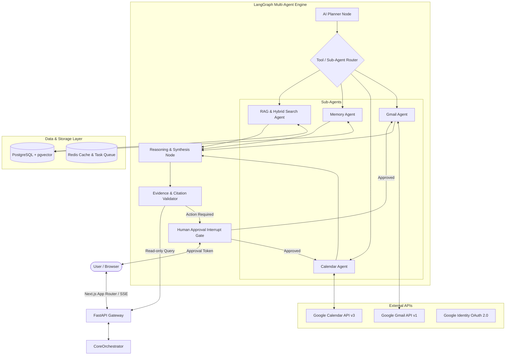

# Product Requirement Document (PRD)
# MailMind — Agentic Personal Productivity Assistant

> **Status:** This is a target-state proposal and implementation roadmap, not a description of shipped capabilities. The current repository is an early-stage local API prototype; see `README.md` for implemented behavior and limitations.

**Project Name:** MailMind  
**Version:** 0.1.0 (Target-State Draft)
**Author:** Kartik Pant  
**Target:** Production Portfolio / Open Source System / Enterprise AI Assistant  
**Reference Origin:** `langchain-ai/agents-from-scratch` (Foundation & Learning Reference)  
**Target Stack:** Next.js (TypeScript) + FastAPI + LangGraph + PostgreSQL (pgvector) + Google Workspace APIs + Docker  

---

## 1. Executive Summary & Product Vision

### 1.1 The Vision
**MailMind** is an autonomous personal productivity and email intelligence agent. Unlike simple email clients or chatbot wrappers that merely summarize unread messages, MailMind acts as a proactive, context-aware executive assistant. It integrates **Gmail**, **Google Calendar**, and **persistent multi-session user memory** into an orchestrated multi-agent reasoning graph.

MailMind can:
1. Plan complex multi-source inquiries across emails, calendar schedules, and long-term user preferences.
2. Cross-reference disparate communications (e.g., matching recruiter interview emails with calendar availability and company requirements).
3. Ingest, chunk, and embed emails into a vector store for semantic, multi-hop RAG with source-backed citations.
4. Draft contextual replies following persistent user preferences (tone, brevity, sign-offs).
5. Maintain strict **Human-in-the-Loop (HITL)** controls so no email is ever sent or calendar invite altered without explicit user authorization.
6. Provide an observable **Agent Trace UI** that displays real-time execution steps, tool invocations, token latencies, and reasoning trees.

---

## 2. Lineage Matrix: Reference vs. MailMind

To make this project completely your own and interview-defensible, this matrix outlines what is adapted from `agents-from-scratch` versus what is architected uniquely for MailMind:

| Capability | LangChain `agents-from-scratch` Reference | MailMind (Your Owned System) |
|---|---|---|
| **Graph Structure** | Simple single-agent graph with triage router & interrupt | **Hierarchical Multi-Agent Graph**: Central Planner + Specialized Sub-Agents (Gmail, Calendar, Memory, RAG, Evidence Validator) |
| **Data Storage** | Ephemeral in-memory store or local SQLite checkpoint | **Production PostgreSQL + pgvector**: Relational storage for users, accounts, emails, and persistent vector embeddings |
| **Email Retrieval** | Live Gmail API search queries only (ephemeral) | **Hybrid Search**: Real-time Gmail API fetching + Automated ingestion pipeline into pgvector for multi-hop historical RAG |
| **Calendar Support** | Mock / rudimentary schedule tool | **Full Google Calendar API v3**: Multi-calendar search, collision detection, smart time-slot proposal |
| **Memory System** | Simple key-value store per profile namespace | **Dual-Tier Memory**: Short-term conversational state + Long-term semantic profile extractor with background reinforcement |
| **User Interface** | CLI terminal or LangGraph Studio | **Modern Web Application**: Next.js App Router, Tailwind CSS, dark glassmorphism, responsive sidebar, streaming trace |
| **Observability** | Console print statements / basic trace | **Interactive Agent Trace Dashboard**: Step-by-step tree visualization, latency tracker, token usage, tool payloads |
| **Human-in-the-Loop** | CLI confirmation or LangGraph Studio interrupt | **Interactive Review Deck**: Draft editor, diff view, approve/reject/regenerate modals over SSE / WebSockets |
| **Evaluation** | Minimal test scripts | **Automated Eval Benchmark**: LangSmith evaluation suite assessing tool accuracy, citation precision, and task completion |
| **Deployment** | Local Python scripts | **Containerized Microservices**: Docker Compose (Next.js, FastAPI, PostgreSQL+pgvector, Redis) ready for AWS/GCP |

---

## 3. High-Level System Architecture



---

## 4. Detailed Feature Specifications

### 4.1 Feature 1: Google Identity & OAuth 2.0 Ingestion
- **Protocol:** Authorization Code Flow with PKCE.
- **Scopes Requested:**
  - `https://www.googleapis.com/auth/gmail.modify` (Read, draft, trash, mark read)
  - `https://www.googleapis.com/auth/gmail.send` (Send emails upon human approval)
  - `https://www.googleapis.com/auth/calendar.events` (Read & write calendar events)
  - `openid email profile`
- **Security:** Refresh tokens encrypted with AES-256-GCM before database persistence. Auto-refresh handler when access token expires.

### 4.2 Feature 2: Planner-Driven Agent Orchestration
- **Concept:** Rather than asking an LLM to blindly pick a tool, a dedicated **Planner Node** breaks complex questions into a Directed Acyclic Graph (DAG) of sub-tasks.
- **Decomposition Example:**
  - *User:* "What internship interviews do I have next week and what prep did they ask for?"
  - *Planner Output:*
    1. `calendar.get_events(time_min=next_week_start, time_max=next_week_end, query="interview")`
    2. `gmail.search(query="interview preparation OR assignment OR interview details")`
    3. `rag.retrieve(query="company preparation interview instructions", top_k=5)`
    4. `memory.get_profile(category="interview_preferences")`
    5. `synthesize(evidence=[events, emails, rag_results, memory])`

### 4.3 Feature 3: Hybrid Email RAG (Vector + Metadata)
- **Ingestion Worker:** Background job fetches recent emails, cleans raw MIME/HTML, chunks content (512 tokens with 64 token overlap), and generates vector embeddings via `text-embedding-3-small` or `text-embedding-004`.
- **Metadata Tagging:** Every chunk contains `email_id`, `thread_id`, `sender`, `recipient`, `subject`, `date_iso`, `has_attachment`.
- **Hybrid Search Algorithm:** Reciprocal Rank Fusion (RRF) combining:
  1. PostgreSQL Full-Text Search (`tsvector` over subject and body).
  2. Dense Vector Similarity (`cosine distance` via pgvector).

### 4.4 Feature 4: Dual-Tier Memory System
1. **Short-Term Memory (Conversational Working Memory):**
   - Thread-level state managed by LangGraph checkpoints.
   - Retains context within the active session (e.g., "Exclude the Amazon email").
2. **Long-Term Memory (User Behavioral & Preference Store):**
   - Extracted asynchronously by a Memory Auditor node.
   - Categorized into:
     - `communication_style` (e.g., "Prefers direct answers under 3 sentences, no informal emojis").
     - `schedule_habits` (e.g., "Does not schedule calls before 10 AM IST").
     - `entities_and_relations` (e.g., "Professor Sharma teaches Distributed Systems").
   - Automatically injected into system prompts for personalized reasoning.

### 4.5 Feature 5: Multi-Hop Evidence Verification & Citations
- **Hallucination Prevention:** Before generating the final response, an **Evidence Checker** node inspects all claims against retrieved email snippets and calendar IDs.
- **Citation Format:** Every response embeds clickable source chips:
  - `[Source: Gmail | "Internship Offer - Stripe" | Oct 14, 2026]`
  - `[Source: Calendar | "Technical Interview with Stripe" | Oct 18, 2026, 4:00 PM]`

### 4.6 Feature 6: Human-in-the-Loop (HITL) Action Guardrails
- **Zero Blind Execution:** Destructive or external actions (`send_email`, `delete_event`, `create_calendar_invite`) trigger a LangGraph `interrupt`.
- **State Pause & Resume:** The workflow execution graph freezes state in PostgreSQL checkpoint storage and returns an actionable review payload to the frontend.
- **Options for the User:**
  - **Approve:** Resumes graph execution, calls Gmail/Calendar API to execute.
  - **Edit:** Modifies subject, recipients, or email body, then resumes.
  - **Reject / Regenerate:** Provides human feedback to the prompt, routing back to the drafting agent.

### 4.7 Feature 7: Live Agent Trace & Observability
- **Real-Time Streaming:** The backend streams graph node transitions via Server-Sent Events (SSE).
- **Frontend Trace Visualizer:**
  - Displays graph nodes: `planner` ➔ `gmail_search` ➔ `calendar_lookup` ➔ `evidence_verifier` ➔ `final_response`.
  - Shows execution latency (ms), tool inputs/outputs, model name, and token count per step.

---

## 5. Database Schema & Data Models

### 5.1 Tables Specification
```sql
-- 1. Users
CREATE TABLE users (
    id UUID PRIMARY KEY DEFAULT gen_random_uuid(),
    email VARCHAR(255) UNIQUE NOT NULL,
    full_name VARCHAR(255),
    picture_url TEXT,
    created_at TIMESTAMP WITH TIME ZONE DEFAULT NOW(),
    updated_at TIMESTAMP WITH TIME ZONE DEFAULT NOW()
);

-- 2. OAuth Credentials
CREATE TABLE connected_accounts (
    id UUID PRIMARY KEY DEFAULT gen_random_uuid(),
    user_id UUID REFERENCES users(id) ON DELETE CASCADE,
    provider VARCHAR(50) DEFAULT 'google',
    encrypted_access_token TEXT NOT NULL,
    encrypted_refresh_token TEXT NOT NULL,
    token_expiry TIMESTAMP WITH TIME ZONE NOT NULL,
    scopes TEXT[] NOT NULL,
    created_at TIMESTAMP WITH TIME ZONE DEFAULT NOW()
);

-- 3. Emails Metadata
CREATE TABLE emails (
    id UUID PRIMARY KEY DEFAULT gen_random_uuid(),
    user_id UUID REFERENCES users(id) ON DELETE CASCADE,
    gmail_message_id VARCHAR(255) NOT NULL,
    gmail_thread_id VARCHAR(255) NOT NULL,
    sender VARCHAR(255) NOT NULL,
    recipient TEXT NOT NULL,
    subject TEXT,
    snippet TEXT,
    body_clean TEXT,
    internal_date TIMESTAMP WITH TIME ZONE NOT NULL,
    labels TEXT[],
    is_read BOOLEAN DEFAULT FALSE,
    UNIQUE(user_id, gmail_message_id)
);

-- 4. Email Vector Embeddings (RAG)
CREATE EXTENSION IF NOT EXISTS vector;

CREATE TABLE email_chunks (
    id UUID PRIMARY KEY DEFAULT gen_random_uuid(),
    email_id UUID REFERENCES emails(id) ON DELETE CASCADE,
    chunk_index INT NOT NULL,
    content TEXT NOT NULL,
    embedding vector(1536), -- compatible with text-embedding-3-small
    metadata JSONB DEFAULT '{}',
    created_at TIMESTAMP WITH TIME ZONE DEFAULT NOW()
);
CREATE INDEX ON email_chunks USING ivfflat (embedding vector_cosine_ops) WITH (lists = 100);

-- 5. Long-term User Memory
CREATE TABLE user_memories (
    id UUID PRIMARY KEY DEFAULT gen_random_uuid(),
    user_id UUID REFERENCES users(id) ON DELETE CASCADE,
    category VARCHAR(50) NOT NULL, -- 'preference', 'entity', 'rule'
    content TEXT NOT NULL,
    confidence_score FLOAT DEFAULT 1.0,
    source_message_id TEXT,
    created_at TIMESTAMP WITH TIME ZONE DEFAULT NOW(),
    updated_at TIMESTAMP WITH TIME ZONE DEFAULT NOW()
);

-- 6. LangGraph State Checkpointer & Runs
CREATE TABLE agent_runs (
    id UUID PRIMARY KEY DEFAULT gen_random_uuid(),
    user_id UUID REFERENCES users(id) ON DELETE CASCADE,
    thread_id VARCHAR(255) NOT NULL,
    user_query TEXT NOT NULL,
    final_response TEXT,
    total_tokens INT DEFAULT 0,
    latency_ms INT DEFAULT 0,
    trace_data JSONB DEFAULT '[]',
    status VARCHAR(50) DEFAULT 'completed', -- 'running', 'interrupted', 'completed', 'failed'
    created_at TIMESTAMP WITH TIME ZONE DEFAULT NOW()
);
```

---

## 6. API Route Specification (FastAPI)

### Authentication
- `GET /api/v1/auth/google/login` — Redirect to Google OAuth consent page.
- `GET /api/v1/auth/google/callback` — Exchange auth code, encrypt tokens, set secure HTTP-only JWT cookie.
- `POST /api/v1/auth/logout` — Invalidate session and revoke tokens.
- `GET /api/v1/auth/me` — Return current authenticated user profile.

### Chat & Agent Execution
- `POST /api/v1/chat` — Initiates an agent execution run (Returns SSE streaming response with tokens and trace nodes).
- `POST /api/v1/chat/resume` — Resumes an interrupted run following user approval/rejection.
- `GET /api/v1/chat/threads` — Lists past conversations for current user.
- `GET /api/v1/chat/threads/{thread_id}/runs` — Fetches complete execution traces for inspection.

### Workspace Integrations
- `GET /api/v1/emails/recent` — Fetches cached/synced emails with pagination and search query.
- `POST /api/v1/emails/sync` — Triggers background ingestion of latest messages into pgvector.
- `GET /api/v1/calendar/events` — Returns upcoming calendar events with filter for next N days.

### Memory Management
- `GET /api/v1/memory` — Returns all extracted long-term user preferences and entities.
- `POST /api/v1/memory` — Allows user to manually teach MailMind a preference.
- `DELETE /api/v1/memory/{id}` — Deletes an outdated or unwanted memory item.

---

## 7. Frontend User Experience & Pages

Built with **Next.js 14+ (App Router)** and **Tailwind CSS**:
1. **`/dashboard`**: Overview containing Unread Priority Emails, Upcoming Calendar Events, AI-generated Daily Briefing ("Here are 3 items that require your action today").
2. **`/assistant`**: Chat interface with real-time SSE streaming, interactive citations chips, draft approval cards, and side-panel agent trace viewer.
3. **`/emails`**: Clean email browser with semantic search bar powered by pgvector.
4. **`/calendar`**: Schedule view highlighting cross-referenced emails next to calendar slots.
5. **`/memory`**: Visual memory management panel where users can review, toggle, edit, or delete what MailMind has remembered about them.
6. **`/trace/{run_id}`**: Deep-dive observability view showing the complete LangGraph execution graph, tool arguments, outputs, and token metrics.

---

## 8. Evaluation & Benchmarking Suite

MailMind includes an automated evaluation framework:
- **Evaluation Dataset:** 30 synthetic and sanitized real-world scenarios covering:
  - Single-source retrieval (Gmail only).
  - Cross-source reasoning (Gmail + Calendar).
  - Memory persistence verification.
  - Safe refusal & HITL interrupt validation.
- **Evaluation Metrics (via LangSmith or Custom Evaluator):**
  1. **Tool Selection Accuracy:** Did the planner call the correct tool?
  2. **Retrieval Precision / Recall:** Did the RAG step retrieve the grounding emails?
  3. **Faithfulness / Hallucination Rate:** Are all claims in the final answer backed by retrieved text?
  4. **HITL Integrity:** Did any email get sent without hitting the interrupt gate? (Target: 100% compliance).

---

## 9. 8-Week Implementation Roadmap

```
Week 1: Foundations & Infrastructure
├── Initialize FastAPI backend & Next.js frontend
├── Configure PostgreSQL + pgvector via Docker Compose
└── Implement Google OAuth2 Authorization Code flow with AES-256 token encryption

Week 2: Gmail & Calendar Tool Harness
├── Integrate Gmail API v1 (Search, Read, Thread, Draft, Send)
├── Integrate Google Calendar API v3 (List events, Find conflicts, Schedule)
└── Write unit tests and mock fixtures for offline testing

Week 3: LangGraph Core Orchestrator
├── Define Agent State Schema with TypedDict & MessagesState
├── Implement Planner Node for question decomposition
└── Wire up Tool Calling Nodes with conditional routing

Week 4: Hybrid RAG Pipeline over Emails
├── Background email ingestion and cleaning worker
├── Text chunking and embedding generation (pgvector)
└── Hybrid reciprocal rank fusion search node

Week 5: Dual-Tier Memory System
├── Conversation checkpointing in PostgreSQL
├── Background Memory Extraction Node for user preferences
└── Memory retrieval and system prompt augmentation

Week 6: Human-in-the-Loop & Verification
├── LangGraph interrupt handlers for draft & send actions
├── Evidence Checker & Citation formatting nodes
└── Retry loops for missing evidence

Week 7: Frontend Application & Real-time Trace
├── Next.js App Router UI with modern dark-mode aesthetic
├── Server-Sent Events (SSE) streaming chat client
├── Interactive Approval Card component (Approve / Edit / Reject)
└── Interactive Agent Trace timeline component

Week 8: Evaluation, Hardening & Portfolio Presentation
├── Automated benchmark suite (LangSmith / pytest)
├── Production Docker packaging & cloud deployment guide
└── Comprehensive GitHub README with architecture diagrams and demo walkthrough
```
